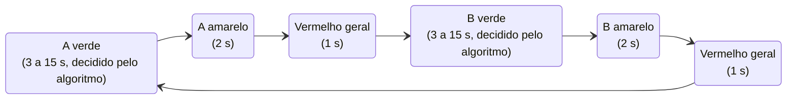

# Algoritmo de fila

Como o Raspberry Pi decide quanto tempo de verde cada via recebe, por que isso é seguro e como o
algoritmo foi avaliado. Visão geral do sistema: [README](../README.md). Regras do código: [AGENTS.md](../AGENTS.md).

## 1. Ideia em uma frase

Quando chega a vez de uma via abrir, o Pi olha quantos carros estão parados nela e dá **verde suficiente
para escoar a fila**, nunca menos que **3 s** nem mais que **15 s**.

No ciclo fixo, toda via recebe sempre 5 s de verde, esteja cheia ou vazia. No algoritmo de fila, a via
cheia recebe mais tempo e a vazia libera o cruzamento mais cedo.

## 2. O cruzamento

As 4 vias formam dois grupos que nunca podem abrir ao mesmo tempo:

| Grupo | Vias | Semáforos |
|---|---|---|
| **A** | N (norte) e S (sul) | S1 e S3 |
| **B** | L (leste) e O (oeste) | S2 e S4 |

As duas vias de um grupo abrem e fecham juntas. Por isso o algoritmo decide o verde **por grupo**, não por via.

## 3. Sequência de fases

O algoritmo **não muda a ordem das fases**, só a duração dos dois verdes. A ordem é sempre:



Consequências:

- Toda troca passa por amarelo e vermelho geral (nunca verde → vermelho direto, nunca A e B juntas).
- O ciclo completo dura de **12 s** (3 + 2 + 1 + 3 + 2 + 1, tudo vazio) a **36 s** (15 + 2 + 1 + 15 + 2 + 1, tudo cheio).

## 4. A regra de decisão

O verde de um grupo é decidido **no instante em que ele vai abrir**, ou seja, no fim do vermelho geral
que o precede:

```
fila_do_grupo = maior fila entre as duas vias do grupo
verde         = fila_do_grupo × segundos_por_veículo
verde         = limitado ao intervalo [verde_mínimo, verde_máximo]
```

Com os valores atuais (`SEC_PER_VEHICLE = 1`, `MIN_GREEN_S = 3`, `MAX_GREEN_S = 15`):

| Filas no momento da decisão | Fila do grupo | Cálculo | Verde |
|---|---|---|---|
| N = 10, S = 5 | 10 | 10 × 1 s = 10 s | **10 s** |
| N = 2, S = 1 | 2 | 2 × 1 s = 2 s, abaixo do mínimo | **3 s** |
| L = 0, O = 0 | 0 | 0 s, abaixo do mínimo | **3 s** |
| L = 30, O = 4 | 30 | 30 s, acima do máximo | **15 s** |

Por que essas escolhas:

- **Maior fila do grupo (e não a soma):** as duas vias do grupo escoam **em paralelo**, cada uma pela sua
  faixa. Quem define quanto tempo o grupo precisa é a via mais cheia; somar dobraria o tempo sem necessidade.
- **Segundos por veículo (`SEC_PER_VEHICLE`):** é o tempo que um carro leva para cruzar depois do anterior
  (na engenharia de tráfego, o *headway de saturação*). Na maquete usamos 1 s.
- **Verde mínimo (3 s):** evita um verde tão curto que ninguém consiga reagir, e dá passagem mesmo se a
  contagem estiver errada (ex.: a câmera não viu um carro).
- **Verde máximo (15 s):** limita quanto a outra via pode esperar (ver a seção 5).

No log do `make run-sim`, cada decisão aparece assim:

```
12:41:58 INFO    verde A: fila N=10 S=5 -> 10.0 s
12:41:58 INFO    fase A_GREEN     10.0 s  {'N': 'green', 'S': 'green', 'L': 'red', 'O': 'red'}
```

## 5. Garantias de segurança

### Nenhuma via espera para sempre (anti-inanição)

Como os grupos **sempre se alternam**, uma via no vermelho espera no máximo:

```
amarelo dela (2) + vermelho geral (1) + verde máximo do outro grupo (15) + amarelo do outro (2) + vermelho geral (1)
= 21 s sem verde
```

Isso vale **mesmo que a contagem esteja errada**: se a câmera disser que uma via está vazia, ela ainda recebe
o verde mínimo de 3 s em todo ciclo. Há um teste que força a contagem de uma via em zero e a outra em 99 e
confere esse limite (`test_no_road_starves_even_if_counter_says_empty`).

### O algoritmo não consegue causar conflito

O algoritmo só devolve **um número** (segundos de verde). Quem monta os estados das vias é a máquina de
fases, que nunca abre A e B juntas. Além disso, o `build_cmd()` do Pi recusa comandos com conflito e o
ESP32 também os rejeita. São três barreiras independentes.

### Se o Pi falhar

O ESP32 continua seguro sozinho: sem comandos por 10 s, ele volta ao ciclo local fixo (5/2/1 s). Quando o
Pi volta, ele retoma pelo amarelo da via que estiver aberta.

## 6. De onde vêm as filas

O algoritmo pede a contagem a uma interface, `VehicleCounter`, que só precisa responder quantos veículos
estão parados em cada via:

```python
class VehicleCounter(Protocol):
    def counts(self) -> dict[str, int]: ...   # ex.: {"N": 10, "L": 0, "S": 5, "O": 1}
```

Hoje quem responde é o **tráfego simulado** (`SimulatedTraffic`). Na etapa de visão computacional (E4), a
câmera vai implementar a mesma interface, e o algoritmo não muda.

### Modelo do tráfego simulado

A simulação avança em pequenos passos de tempo e, a cada passo:

1. **Chegadas:** cada via recebe carros aleatoriamente, com uma taxa média em veículos por segundo
   (`ARRIVALS`, padrão `N=0.35, S=0.3, L=0.1, O=0.1`). Ex.: taxa 0,35 = em média um carro a cada ~2,9 s.
2. **Saídas:** se a via está **verde**, sai um carro a cada `SEC_PER_VEHICLE` (1 s), o mais antigo primeiro.
   No amarelo e no vermelho ninguém sai.
3. **Medição:** cada carro guarda o instante em que chegou. Ao sair, o tempo parado entra na estatística.

## 7. Como o algoritmo foi avaliado

### Métrica

**Tempo médio de espera por veículo** (decisão D3), do momento em que o carro chega até cruzar. Ao fim da
simulação, os carros que ainda estão na fila também entram na média com o tempo que já esperaram, para não
esconder filas que nunca andam. Métricas secundárias: maior fila observada e veículos atendidos.

### Método

`make simular` roda os dois métodos sobre **as mesmas chegadas de carros**: o ciclo fixo (verde de 5 s) e o
algoritmo de fila. Cada comparação simula 30 minutos e é repetida 5 vezes com sementes aleatórias
diferentes, e o resultado é a média. Tudo roda em tempo simulado, em cerca de 1 s, sem MQTT nem placa.

### Resultados

| Cenário (veículos/s) | Ciclo fixo | Algoritmo de fila |
|---|---|---|
| Leve e equilibrado: 0,1 em todas | 5,9 s · fila máx. 8 | 5,8 s · fila máx. 6 |
| Pesado e equilibrado: 0,25 em todas | 12,0 s · fila máx. 27 | **9,1 s** · fila máx. 13 |
| A carregada (padrão): N=0,35 S=0,3 L=0,1 O=0,1 | 58,1 s · fila máx. 100 | **8,7 s** · fila máx. 14 |
| A muito carregada: N=0,5 S=0,5 L=0,05 O=0,05 | 297,8 s · fila máx. 377 | **11,9 s** · fila máx. 23 |

Para reproduzir um cenário: `edge/.venv/bin/semaphor-edge simular --chegadas N=0.5,S=0.5,L=0.05,O=0.05`.

### Por que o ciclo fixo colapsa nos cenários desbalanceados

A **capacidade** de uma via é quantos carros por segundo ela consegue escoar no longo prazo:

```
capacidade = verde da via / duração do ciclo × (1 veículo / SEC_PER_VEHICLE)
```

- **Ciclo fixo:** 5 s de verde num ciclo de 16 s, ou seja **0,31 veículo/s**. Se chegam 0,35 carro/s, a
  fila cresce sem parar (por isso a fila máxima de 100 e a espera de 58 s).
- **Algoritmo de fila, via A cheia e B quase vazia:** A recebe até 15 s e B só 3 s, num ciclo de
  15 + 2 + 1 + 3 + 2 + 1 = 24 s. A capacidade de A sobe para **0,62 veículo/s**.
- **Algoritmo de fila, as duas cheias:** ciclo de 36 s, capacidade de **0,42 veículo/s** por via. Acima
  disso, nenhum dos dois métodos dá conta; aumentar o verde máximo ajudaria, ao custo de esperas maiores.

Com tráfego leve, o algoritmo quase não muda nada (todas as filas cabem no verde mínimo), e os dois métodos empatam.

### Limitações do modelo

- Chegadas aleatórias independentes, sem pelotões de carros nem horários de pico.
- Saída constante de 1 carro/s no verde, sem tempo de arranque nem carros cruzando no amarelo.
- A fila é medida só no início do verde; carros que chegam durante o verde também passam, mas não
  aumentam o verde já decidido.
- Nenhuma conversão à esquerda nem pedestres.

Os números servem para **comparar os dois métodos** nas mesmas condições, não para prever o tráfego de um
cruzamento real.

## 8. Parâmetros

Todos ficam no `edge/.env` (modelo em `edge/.env.example`):

| Variável | Padrão | Efeito |
|---|---|---|
| `MIN_GREEN_S` | 3 | Verde mínimo de cada grupo |
| `MAX_GREEN_S` | 15 | Verde máximo; também limita a espera da outra via |
| `SEC_PER_VEHICLE` | 1 | Segundos de verde por carro na fila (e vazão da simulação) |
| `YELLOW_S`, `ALL_RED_S` | 2, 1 | Amarelo e vermelho geral (iguais ao ciclo local do ESP32) |
| `GREEN_S` | 5 | Verde do ciclo fixo (`make run` sem simulação e linha de base do `simular`) |
| `ARRIVALS` | `N=0.35,S=0.3,L=0.1,O=0.1` | Chegadas do tráfego simulado (veículos/s) |

Ao mudar um parâmetro, rode `make simular` para ver o efeito antes de testar na maquete.

## 9. Como usar

| Comando | O que faz |
|---|---|
| `make simular` | Compara ciclo fixo e algoritmo offline e imprime a tabela |
| `make run-sim` | Controla a maquete com o algoritmo e tráfego simulado (mostra cada decisão no log) |
| `semaphor-edge run --simulado --chegadas N=0.6,S=0.4,L=0.1,O=0.1` | Mesmo, com outro cenário |
| `make run` | Ciclo fixo (sem algoritmo) |

## 10. Onde está no código

| Arquivo | Responsabilidade |
|---|---|
| `edge/src/semaphor_edge/policy.py` | `QueuePolicy`: a regra de decisão (seção 4) e os limites `QueueParams` |
| `edge/src/semaphor_edge/phases.py` | Sequência de fases; consulta a policy ao entrar em cada verde (`green_policy`) |
| `edge/src/semaphor_edge/traffic.py` | `VehicleCounter` (interface) e `SimulatedTraffic` (seção 6) |
| `edge/src/semaphor_edge/simulation.py` | `simulate()` e `compare()` (seção 7) |
| `edge/src/semaphor_edge/runner.py` | Liga tudo ao MQTT; `on_tick` avança o tráfego simulado em tempo real |
| `edge/tests/test_traffic_policy.py` | Testes da regra, do anti-inanição e da comparação |

### Para testar outra regra

Uma policy é qualquer função `grupo ("A" ou "B") -> segundos de verde`. Para experimentar outra ideia
(ex.: somar as filas, ou dar peso ao tempo de espera), crie uma nova função ou classe em `policy.py`,
compare com `simulation.compare()` e só depois troque no `run`. Não altere a sequência de fases nem os
limites mínimo e máximo sem rever a seção 5.

### Melhorias possíveis

- **Pular a fase vazia (E3.4):** se um grupo não tem carros, não abri-lo, desde que o anti-inanição continue valendo.
- **Verde atuado:** em vez de decidir o verde só no início, estendê-lo enquanto chegam carros, até o máximo.
- **Prever chegadas:** somar à fila os carros esperados durante o próprio verde (taxa × verde).
